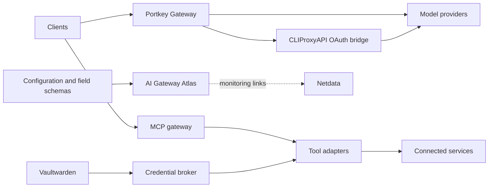

# AI Gateway Atlas

A generated configuration atlas for an AI gateway environment. Jekyll renders
connection requirements, example credential layouts, device records and access
policy from explicit JSON inputs. It is documentation, not an admin control plane.

The sample describes Portkey for model routing, Vaultwarden for stored credentials,
a custom credential broker, a CLIProxyAPI OAuth bridge, and Netdata for monitoring.
Product names are real; every organization, device, hostname, profile and access
group in the sample is fictional. The owner restrictions shown here are custom
broker policy, not a claim about Portkey-native RBAC.

## Example architecture



Atlas reads the explicit configuration files described below. It does not discover
a Portkey installation or change its settings. The diagram illustrates one deployment
pattern; the template can document a smaller setup too.

## Build the fictional sample

Requirements: Python 3.11+ and Docker on a Linux build host. No Python packages,
Ruby installation, Jekyll plugins or web application runtime are required on the
serving host. The first build downloads the digest-pinned Ruby image and locked
Jekyll gems. Subsequent rendering runs without a network connection.

```sh
python3 scripts/build_reference.py \
  --input-directory docs/reference/demo \
  --output-directory dist \
  --revision fictional-demo
```

Serve `dist/index.html` and `dist/examples.html` using an ordinary static web
server. The only browser script is the local clipboard helper; it does not fetch
data, access the vault or probe services. Health checks belong in Netdata, linked
through `presentation.json`.

## Bring your own configuration

Start a separate, private input directory containing four JSON files:

| Input | Purpose |
| --- | --- |
| `contracts.json` | Service/model connection descriptions and credential field schemas |
| `access-groups.json` | Owners, groups, service tags and explicit credential-owner restrictions |
| `device-access.json` | Recorded device membership and enrollment/setup notes |
| `presentation.json` | Brand, monitoring link, optional setup link and explanatory notes |

Use the fictional files as the schema examples. Pass the private directory with
`--input-directory`. Keep it outside any public repository. Use documentation
placeholders in credential fields; never paste an actual password, token or key.
A field with `secret: true` must have a single `<placeholder>` as its example and
may not declare an exact value or alternatives. Unknown input properties are not
exported. The build does not read Vaultwarden, environment credentials, live
configuration endpoints, certificate stores or encrypted vault backups.

When `--input-directory` is omitted, this integration also supports a repository
layout with `docs/reference/contracts.json`, `docs/reference/device-access.json`,
`docs/reference/presentation.json` and `gateway/access-groups.json`. This is a
source snapshot, not proof that a deployment is running that configuration.
Device notes are operator-maintained records, not probes.

Keep rendered pages private when they document private infrastructure. Static
output can expose names, services and policy even when it has no secrets. Never
make an existing operational repository public to share this template.

## Rebuild and provenance

Rebuild on configuration changes and use a scheduled daily rebuild as a fallback.
The scheduler is infrastructure-specific; the template does not install a job.
Every build records the UTC generation time, caller-supplied or Git revision,
individual input hashes and a SHA-256 digest of all inputs/templates. Build into
a staging directory and deploy only the two HTML files after success. A failed
build should leave the previous pages untouched.

For deterministic output, add `--generated-at 2026-01-01T00:00:00Z --revision demo`.
To check existing output without rewriting the recorded build time:

```sh
python3 scripts/build_reference.py \
  --input-directory docs/reference/demo --output-directory dist --check
```

## Dependency boundary

`docs/reference/site/Gemfile.lock` pins Jekyll 4.4.1 and all transitive gems with
checksums. The Ruby base image is digest-pinned. The renderer uses Jekyll safe
mode, strict Liquid parsing, no plugins, a read-only filesystem, no network,
a memory/process bound, no additional capabilities, and only a sanitized staging
directory. It publishes an exact allowlist: `index.html` and `examples.html`.
The build image is keyed by Dockerfile/Gemfile/lockfile contents. OS build packages
come from the base image's Alpine repository and are not individually hash-locked.

Run the separate, network-enabled dependency audit when changing the lock:

```sh
python3 scripts/build_reference.py --audit
```

That downloads the current Ruby advisory database and reports known advisories;
it is not a complete audit of every dependency. No credentials are needed.
